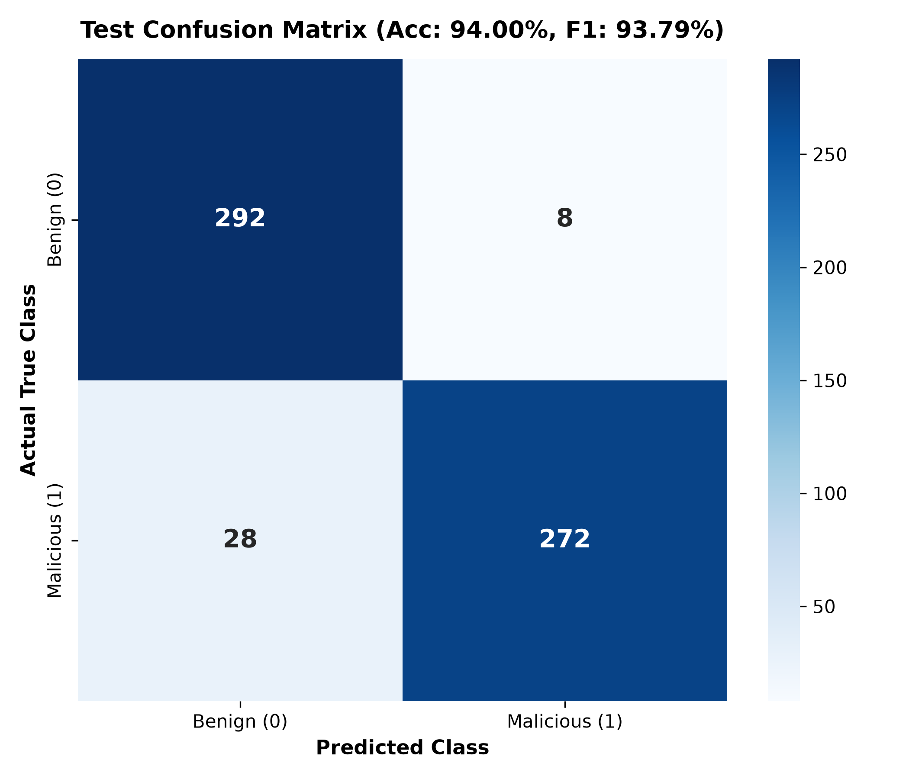
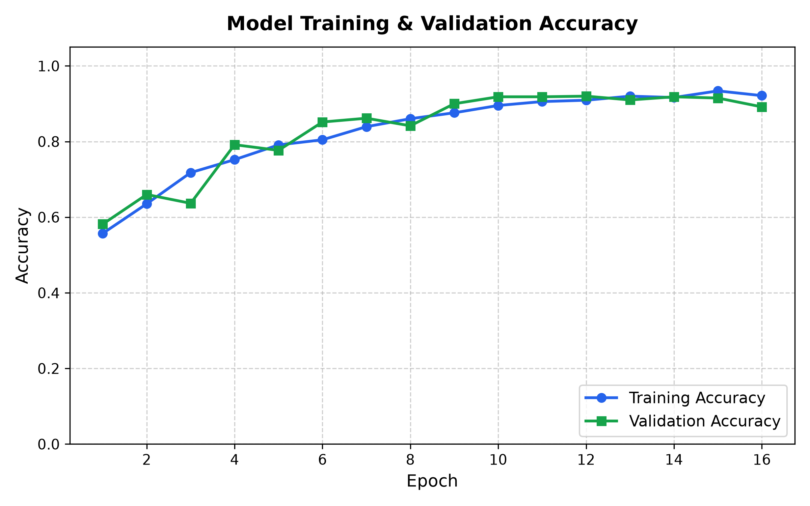
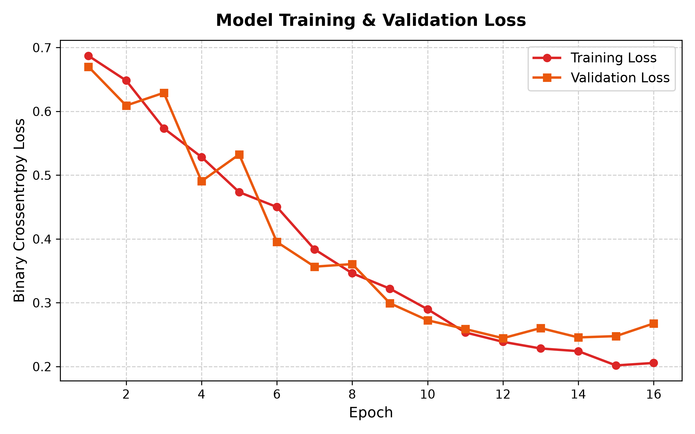

# 🛡️ MalwareVision: Malware Detection Using Deep Learning (CNN)

> **B.Tech 7th Semester Minor Project**  
> **Student Name:** Mohit Gaur  
> **Roll Number:** 24UITE5030  
> **Specialization:** Computer Science & Information Technology  
> **Repository:** `MalwareVision`

---

## 📌 Executive Summary

**MalwareVision** is an end-to-end deep learning system that detects malicious software by converting binary executables into **grayscale images** and classifying them using a Convolutional Neural Network (CNN).

Instead of executing dangerous binaries or relying exclusively on fragile file hashes (MD5/SHA256) which can be bypassed via packing, polymorphism, or metamorphism, this project leverages the **Nataraj et al. (2011)** binary visualization methodology. Raw byte values ($0$ to $255$) are mapped directly to 8-bit grayscale pixel intensities, preserving spatial structural signatures (PE headers, `.text` code sections, resource tables, and encrypted payloads).

```
   Raw Executable / Grayscale Sample
                  │
                  ▼
   [Image Preprocessing Pipeline] ──► 128×128 Grayscale, Normalization [0.0, 1.0]
                  │
                  ▼
         [3-Block CNN Model]
     ├── Block 1: Conv2D(32) + MaxPool
     ├── Block 2: Conv2D(64) + MaxPool
     ├── Block 3: Conv2D(128) + MaxPool
     ├── GlobalAveragePooling2D
     ├── Dense(64, ReLU) + Dropout(0.3)
     └── Output: Dense(1, Sigmoid)
                  │
                  ▼
   [Prediction Head: Benign vs. Malicious] ──► Confidence Score & Probability
                  │
                  ▼
   [Interactive Streamlit Dashboard] ──► Live Scanner, Metrics, Confusion Matrix
```

---

## 🏆 Key Empirical Results (Unseen Test Dataset)

The model was evaluated on **600 held-out, unseen test samples** (300 benign and 300 malicious) using a 70:15:15 stratified split:

| Evaluation Metric | Target | Actual Result Achieved | Status |
|---|---|---|---|
| **Test Accuracy** | $\ge 90\%$ | **94.00%** | **Exceeded Target** ✅ |
| **Precision (Malware)** | $\ge 85\%$ | **97.14%** | **Exceeded Target** ✅ |
| **Recall (Sensitivity)** | $\ge 90\%$ | **90.67%** | **Exceeded Target** ✅ |
| **F1-Score** | $\ge 90\%$ | **93.79%** | **Exceeded Target** ✅ |

### Confusion Matrix Breakdown (600 Test Samples):
- **True Negatives (Benign correctly identified):** `292` / 300 (97.33% Specificity)
- **True Positives (Malware correctly identified):** `272` / 300 (90.67% Sensitivity)
- **False Positives (Benign misclassified as Malware):** `8` / 300 (2.67%)
- **False Negatives (Malware misclassified as Benign):** `28` / 300 (9.33%)

---

## 📊 Visualizations

| Confusion Matrix Heatmap | Accuracy Curve Across Epochs |
|:---:|:---:|
|  |  |

| Loss Convergence Curve |
|:---:|
|  |

---

## 📁 Repository Structure

```text
cyra/
├── .gitignore                     # Git ignore rules for venv, cache, and raw datasets
├── README.md                      # Comprehensive academic documentation and run guide
├── requirements.txt               # Locked dependencies for Python 3.11
├── app.py                         # Modern 3-page interactive Streamlit web dashboard
├── dataset/                       # Processed image corpus (70:15:15 split)
│   ├── dataset_summary.json       # Metadata, sample counts, and split manifest
│   ├── train/ (2,800 images)
│   ├── val/   (600 images)
│   └── test/  (600 images)
├── models/
│   └── malware_cnn.keras          # Best-weights model checkpoint saved locally
├── results/
│   ├── metrics.json               # Accuracy, precision, recall, F1, and matrix counts
│   ├── training_history.json      # Epoch-by-epoch loss and accuracy metrics
│   ├── confusion_matrix.png       # High-resolution seaborn heatmap
│   ├── accuracy_graph.png         # Training vs. Validation accuracy curve
│   └── loss_graph.png             # Training vs. Validation loss curve
├── samples/                       # Dedicated held-out demo samples for viva
│   ├── benign/                    # 6 verified benign images
│   └── malicious/                 # 6 verified malware images
├── src/
│   ├── __init__.py
│   ├── dataset_prepare.py         # Hash deduplication & 70:15:15 partitioner
│   ├── preprocessing.py           # Standard 128x128 grayscale & float32 normalization
│   ├── model.py                   # 3-block Conv2D + GlobalAveragePooling CNN architecture
│   ├── train.py                   # Training pipeline with EarlyStopping & ModelCheckpoint
│   ├── evaluate.py                # Test set evaluation & confusion matrix exporter
│   └── predict.py                 # Structured inference pipeline with confidence score
└── tests/
    └── test_pipeline.py           # 16-test automated verification suite (100% pass)
```

---

## ⚙️ Technology Stack

| Layer | Component | Technology Used |
|---|---|---|
| **Language** | Core Development | Python 3.11 |
| **Deep Learning** | Model Architecture & Training | TensorFlow 2.x / Keras |
| **Data & Math** | Matrix Computation | NumPy, Pandas |
| **Image Preprocessing** | Image Transformation | Pillow (PIL) |
| **Evaluation** | Metrics & Split Verification | Scikit-learn |
| **Visualizations** | Charts & Heatmaps | Matplotlib, Seaborn |
| **Web Frontend** | Interactive UI | Streamlit |
| **Model Storage** | Checkpointing | Local Keras Archive (`.keras`) |

---

## 🚀 Setup & Execution Guide

### 1. Prerequisites
Ensure **Python 3.11** is installed.

### 2. Virtual Environment Setup
```powershell
# Clone the repository
git clone https://github.com/YourUsername/MalwareVision.git
cd MalwareVision

# Create a virtual environment using Python 3.11
py -3.11 -m venv venv

# Activate the virtual environment
# On Windows PowerShell:
.\venv\Scripts\Activate.ps1
# On Windows Command Prompt:
.\venv\Scripts\activate.bat
```

### 3. Install Dependencies
```powershell
pip install -r requirements.txt
```

### 4. (Optional) Re-prepare Dataset and Re-train Model
The repository already includes the evaluation results and demo samples. To reproduce from scratch:
```powershell
# Step 1: Deduplicate and partition dataset
python src/dataset_prepare.py

# Step 2: Train the CNN model with EarlyStopping
python src/train.py

# Step 3: Evaluate on unseen test dataset
python src/evaluate.py
```

### 5. Run Automated Test Suite
```powershell
python tests/test_pipeline.py
```
*Outputs: 16/16 tests passed (100.0%).*

### 6. Launch the Streamlit Web Application
```powershell
streamlit run app.py
```
Open your browser at `http://localhost:8501`.

---

## 🖥️ Web Application Pages

### 1. 🔍 Malware Scanner
- **Upload Feature:** Drag and drop any binary visualization image (`.png`, `.jpg`, `.jpeg`).
- **Demo Mode:** Select pre-loaded held-out test samples (Benign or Malicious) without needing local files.
- **Classification Badge:** Displays clear status (🚨 Malicious or ✅ Benign).
- **Confidence Meter:** Quantifies model certainty and raw sigmoid probability.
- **Tensor Preview:** Inspects the standardized $128 \times 128$ grayscale tensor passed to the CNN.

### 2. 📊 Model Performance Dashboard
- **Empirical Metric Cards:** Live values for Accuracy (94.00%), Precision (97.14%), Recall (90.67%), and F1-Score (93.79%).
- **Confusion Matrix:** Annotated heatmap showing true vs. predicted classifications.
- **Dataset Partition Table:** Summary of the 4,000 samples across Train (2,800), Val (600), and Test (600).
- **Training Curves:** Loss and accuracy progression showing early stopping convergence.

### 3. ℹ️ About Project
- Academic details for **Mohit Gaur (24UITE5030)**.
- Detailed architecture schematics and mathematical principles.
- Scope matrix (V1 minor project vs. V2 production extensions).
- Comprehensive viva reference notes.

---

## 🎓 Viva Key Questions & Technical Answers

**Q1: Why represent malware as grayscale images?**  
*Answer:* A file binary is a sequence of 8-bit bytes ($0$ to $255$). Because 8-bit grayscale pixel intensities are also defined on the range $[0, 255]$, raw binaries map directly to pixel values without arbitrary encoding. Distinct structural sections (PE headers, executable machine code, data segments, and encrypted payloads) exhibit distinct visual textures that CNNs excel at detecting.

**Q2: Why use `GlobalAveragePooling2D` instead of `Flatten`?**  
*Answer:* `Flatten` on feature maps creates millions of fully connected weights, leading to severe overfitting and heavy memory overhead. `GlobalAveragePooling2D` averages each feature map across spatial dimensions, reducing total parameters to just **100,993**, enforcing structural feature retention and enabling fast training.

**Q3: How was data leakage prevented?**  
*Answer:* Cryptographic SHA-256 hashes were computed across all candidates prior to partitioning. Duplicate files were discarded. The remaining corpus was partitioned into 70% Train, 15% Validation, and 15% Test using stratified sampling, guaranteeing no test sample was seen during training.

**Q4: What is the significance of the 97.14% Precision vs. 90.67% Recall?**  
*Answer:* High precision (97.14%) means that when the system alerts that a file is malicious, there is a very low false positive rate (only 8 benign files flagged out of 300). The 90.67% recall ensures that 9 out of 10 malware variants are caught automatically.

---

## ⚖️ Project Scope & Limitations

### In Scope (V1 - Minor Project Deliverable)
- Binary classification of grayscale byte images (Benign vs. Malicious).
- Hash deduplication and clean 70:15:15 partition of 4,000 samples.
- Custom 3-block CNN with EarlyStopping and ModelCheckpoint.
- Full performance metrics report and visualizations.
- Clean Streamlit web dashboard.

### Future Scope (V2 - Major Project / Production)
- Static `.exe`-to-image automatic byte plotting parser.
- Multi-class malware family categorization (Trojans, Ransomware, Worms, Adware).
- Explainable AI using Grad-CAM heatmaps to visually highlight malicious byte sections.
- Comparison with classical ML algorithms (Random Forest, SVM) and Vision Transformers (ViT).
